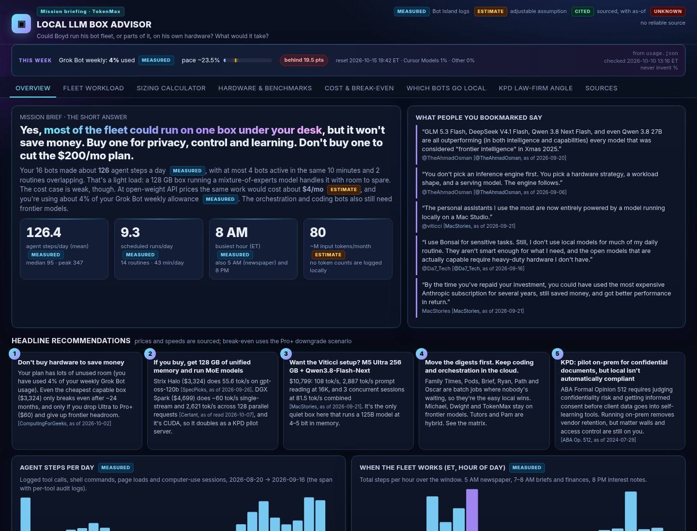
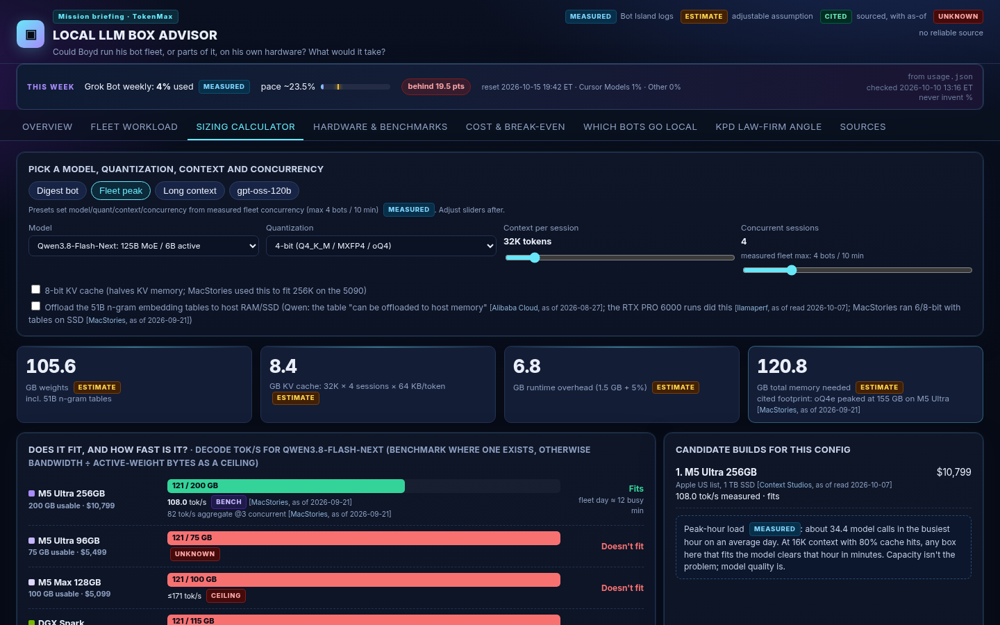
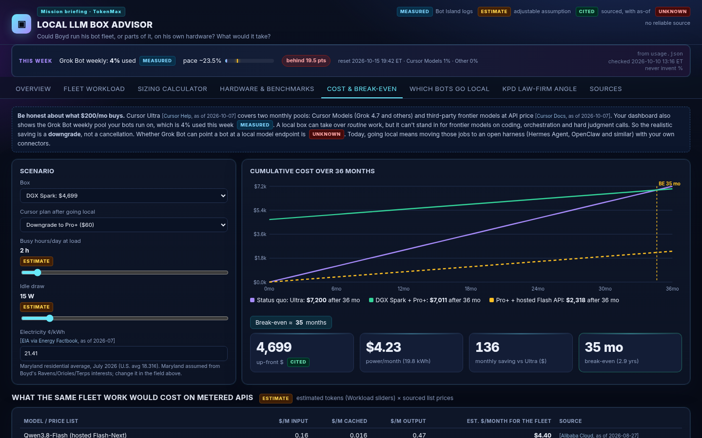
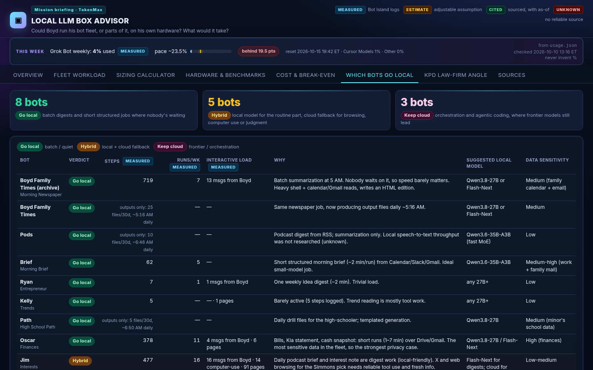
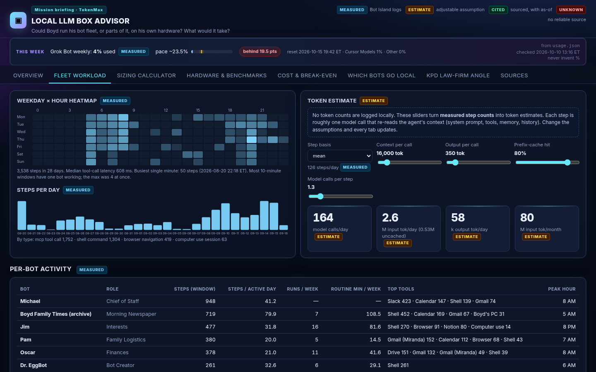
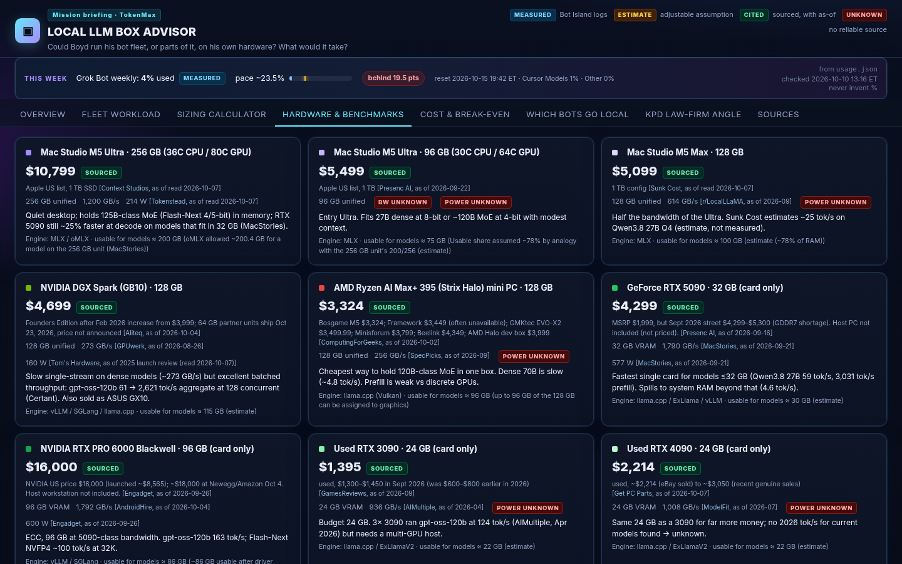
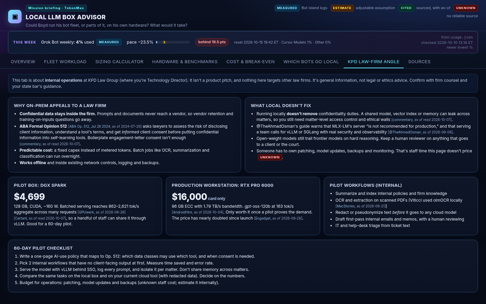

# 🖥️ Local LLM Box Advisor

**Could Boyd run his Grok Bot fleet, or parts of it, on his own hardware, and what would it take?**
This is an interactive local web app that answers that question from his fleet's *real* activity (Bot Island's logs) plus cited
October 2026 hardware research. It covers a sizing calculator, cost and break-even against Cursor Ultra, a "which bots could go local" matrix,
and a KPD Law Group privacy and on-prem section.

Built by TokenMax on Oct 7, 2026 from Grok Bot weekly usage that would otherwise have reset unused. Idea #10 in `../SHORTLIST.md`,
inspired by Boyd's bookmarks from @viticci (M5 Ultra local agents), @TheAhmadOsman (local-LLM "bible") and @Da7_Tech (Bonsai 27B for sensitive tasks).



| Sizing calculator | Cost & break-even |
|---|---|
|  |  |
| **Which bots go local** | **Fleet workload (measured)** |
|  |  |
| **Hardware & benchmarks (all cited)** | **KPD law-firm angle** |
|  |  |


## What's new (Sat Oct 10 afternoon remaster)

TokenMax daily-usage-check deep remaster (idea #10 SHORTLIST):

* Re-ran `analyze.py` against current `../bot-island/data/fleet.json` (read-only) → refreshed `data/workload.json` (same Aug 20–Sep 16 audit window; usage.json re-embedded).
* **Mission briefing** UI: denser header, sticky tab bar, clearer badges (**MEASURED** / **ESTIMATE** / **CITED** / **UNKNOWN**), animated KPI count-ups.
* **This week** strip under the header: Grok Bot weekly pool pace from `/workspace/tokenmax/usage.json` only (used %, pace target, gap pts, reset) — never invents percentages.
* Sizing calculator: one-click presets (Digest / Fleet peak / Long context / gpt-oss-120b) plus count-up memory KPIs.
* Cost break-even chart: yellow BE marker + callout when a payback month exists.
* Which-bots-go-local matrix: row tinting by verdict + legend for readability.
* Hardware panel: explicit note that prices/benchmarks are Oct 2026 research already on disk; remaster did not invent new figures.
* `export_static.py` → `dist/llm-box-advisor-snapshot.html`; `screenshot.sh` → **`screenshots/00-best-home.png`** plus key tabs. Port **4949**.

## Run it

```bash
cd /workspace/tokenmax/llm-box-advisor
./run.sh                       # re-derives the workload, starts the server in the background (idempotent)
# open http://127.0.0.1:4949   (deep links: /?tab=sizing&model=gptoss120, /?tab=cost&hw=strix)
```

No installs needed: Python 3 stdlib plus one HTML/JS page. Other entry points:

| Command | What it does |
|---|---|
| `python3 analyze.py` | Reads `../bot-island/data/fleet.json` (read-only) → writes `data/workload.json` |
| `python3 server.py` | Foreground server, port 4949 (`LLM_ADVISOR_PORT` to change) |
| `python3 export_static.py` | Writes `dist/llm-box-advisor-snapshot.html`, a single offline file you can open anywhere |
| `./screenshot.sh` | 1440×900 screenshots of every tab into `screenshots/` (headless Chrome) |

## How to read the numbers

Every number carries one of four badges:

* **MEASURED**: computed from Bot Island's collected fleet metadata (tool calls, shell commands, page loads, computer-use sessions, routine runs, cron schedules).
* **ESTIMATE**: an assumption you can change with a slider. **No token counts are logged locally**, so tokens come from measured step counts × assumed context/output per call × cache-hit rate. The same goes for memory math (bits/param, KV bytes/token).
* **CITED** (sourced): a price or benchmark quoted from a cited web source, with an "as of" date (the source's own date, or "read 2026-10-07" when it didn't state one). TokenMax did not run any benchmarks.
* **UNKNOWN**: no reliable 2026 source found, so it's shown as a gap rather than a guess.

## Measured fleet profile (audit window Aug 20 → Sep 16, 2026, 28 days)

* **126 agent steps/day** on average (median 95, busiest day 347), 3,538 steps total across 16 bots.
* **9.3 scheduled runs/day** from 14 enabled routines, about 43 routine-minutes/day. At most **2 routines overlapped**, and at most **4 bots** were active in the same 10 minutes.
* Busy hours (ET): **8 AM** (briefs, finances, calendar), **5 AM** (newspaper) and **8 PM** (interest notes).
* Top tools: Shell, Slack, Calendar, Browser, Gmail (×2 accounts), Drive, Notion, computer use.
* Grok Bot weekly usage: read live from `../usage.json` on each `analyze.py` / export (never invented). See the **This week** strip in the UI.

## Headline recommendations

1. **Don't buy hardware to save money.** The fleet is light, and the $200/mo plan has lots of unused room. The same work on a hosted open-weight API (Qwen3.8-Flash list price) comes to about **$4/mo** (estimate). A $3,324 Strix Halo box breaks even only after ~24 months, and only if Ultra is downgraded to Pro+ ($60), which gives up frontier headroom. Buy for privacy, control and learning.
2. **If you buy, get 128 GB of unified memory and run MoE models.** Strix Halo 128 GB ($3,324+) runs gpt-oss-120b at 55.6 tok/s. **DGX Spark ($4,699)** runs it at ~60 tok/s single-stream and 2,621 tok/s across 128 concurrent requests. It's CUDA, so it doubles as a KPD pilot server.
3. **The Viticci setup:** M5 Ultra 256 GB ($10,799) + Qwen3.8-Flash-Next gets 108 tok/s, 2,887 tok/s prompt reading at 16K, and 3 concurrent sessions. It's the quiet "run every non-coding bot locally" box.
4. **Move the digests first, keep coding and orchestration in the cloud.** Go local: Family Times, Pods, Brief, Ryan, Kelly, Path, Oscar (finances, the strongest privacy case). Hybrid: Jim, the tutors, Pam, Dr. EggBot. Keep cloud: Michael, Dwight, TokenMax.
5. **KPD:** pilot on-prem for confidential *internal* document work (summaries, OCR, redaction before cloud). Running locally doesn't automatically satisfy ABA Formal Opinion 512: you still need matter walls, access control and informed consent policies.

Skip for now: **RTX 5090** ($1,999 MSRP, but ~$4,300 on the street in Sept 2026, card only). It's the fastest card for models up to 32 GB, but that 32 GB is a hard ceiling.

## Files

```
llm-box-advisor/
  analyze.py            fleet.json → data/workload.json (measured profile)
  server.py, run.sh     stdlib server on :4949 (/api/data, /api/refresh, /api/health)
  export_static.py      offline single-file snapshot → dist/
  screenshot.sh         1440×900 screenshots → screenshots/
  data/research.json    hardware, models, benchmarks, API prices, quotes, 38 cited sources
  data/workload.json    derived fleet profile
  web/                  index.html, style.css, app.js
  dist/llm-box-advisor-snapshot.html
  screenshots/          00-best-home.png + 01-overview … 10-cost-strix
```

## Known gaps

* No token counts exist locally, so all token and $ figures for the fleet are estimates (adjustable).
* Unknown whether Grok Bot can route a bot to a self-hosted model endpoint. Going local today means re-hosting jobs in an open harness (Hermes Agent, OpenClaw and similar).
* No 2026 tok/s found for Bonsai 27B, a used RTX 4090 on current models, or the M5 Ultra 96 GB bin. No load-power figures for Strix Halo or used GPUs. M5 Ultra 512 GB price not announced.
* KV-cache sizes for the Qwen3.8 hybrid models are derived estimates.
* Host-PC cost for discrete GPUs and staff time to operate a local stack are not priced.
* 2026 prices are volatile (memory/GDDR7 shortage). Verify before buying. Nothing here is purchase, legal or ethics advice.

## Tests

`python3 tests/smoke_test.py` runs read-only checks: every price and benchmark cites a source with an as-of date, the server answers GETs (it never calls /api/refresh), and the offline snapshot is self-contained and carries its MEASURED/ESTIMATE/SOURCED/UNKNOWN labels.


---
## Repo notes
- **Built:** Oct 7, 2026, by TokenMax (Boyd's Grok Bot) on the Grok Bot box.
- **Run:** `./run.sh` (then open the localhost URL it prints).
- Imported from `/workspace/tokenmax/llm-box-advisor` on Oct 23, 2026. node_modules, virtualenvs, logs and files over 20 MB were left out.
